<div align="center">

# ClipShelf

**Keep what you copy. Find it when you need it.**

[English](README.md) · [简体中文](README.zh-CN.md)

A clipboard manager for Mac, with searchable history, collections, and a card-based interface.

**No account required. No subscription.**

</div>

## Download

[**Download ClipShelf 0.12.0 for Mac**](https://github.com/zxdposter/ClipShelf/releases/download/v0.12.0/ClipShelf-0.12.0-macOS-arm64.dmg) · [ZIP download](https://github.com/zxdposter/ClipShelf/releases/download/v0.12.0/ClipShelf-0.12.0-macOS-arm64.zip) · [Release notes](https://github.com/zxdposter/ClipShelf/releases/tag/v0.12.0)

Requires **macOS 14 or later** and a Mac with **Apple silicon (M1 or later)**. Open the DMG and drag ClipShelf into Applications.

This release has not been notarized by Apple. If macOS blocks opening it, review the download and allow it in **System Settings → Privacy & Security → Open Anyway**.

### Install with Homebrew

```sh
brew install --cask zxdposter/tap/clipshelf
```

If Homebrew asks for explicit trust, run `brew trust --cask zxdposter/tap/clipshelf`, then repeat the installation command. If you already installed ClipShelf manually, quit it and move the existing app out of Applications before installing with Brew. Keep your clipboard history and settings in place.

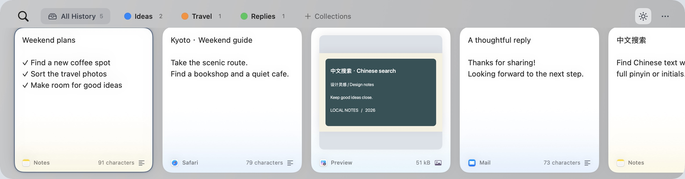

## Your clipboard, within reach

Copy text, links, images, or files, then bring up ClipShelf to find them again. Browse clear, readable cards without leaving your current task behind.

- **Clipboard history** — keep recent copies together instead of losing the previous one.
- **No duplicate clutter** — copying the same content brings its existing card back to the front.
- **Search and filter** — find content, saved titles, or app names; search Chinese with full pinyin or initials (for example, `zhongwen` or `zw` for 中文), and narrow results by content type.
- **Search text in images** — on-device Apple OCR recognizes Chinese and English in the background, including existing image history. Search recognized text in Chinese, full pinyin, or initials, with matching words highlighted in image cards and enlarged previews. Single image files are recognized as images, including previously misclassified history. Results are cached; recognition yields while typing, composing Chinese, or navigating cards.
- **Filter by source app** — choose one or more apps from the filter menu or inline suggestions. Removable app tokens combine with keywords and content types; when they overflow, a count badge shows the full list on hover and individual removal on click. Use ↑↓ and Return to choose a suggestion; otherwise Return focuses results, a second Return pastes, and Tab / Shift-Tab selects the next / previous card.
- **Keep the formatting** — see formatted text, images, and file thumbnails right on the cards.
- **Preview with Space** — take a closer look at text, images, or files before pasting. Select Chinese or English text directly inside an image preview and copy it with **⌘C** or the context menu; **⌘A** selects all recognized text. Link previews open the actual webpage in a scrollable, temporary WebKit session, with back/forward navigation and a manual option to open your browser. The page loads only when you open its preview; browser logins are not shared.
- **Recognize the source** — app icons and colored card footers show where each item came from.

### Chinese, full pinyin, or initials

Find Chinese content without switching input methods: `zhongwen` and `zw` both match 中文. The same matching works for recognized image text.

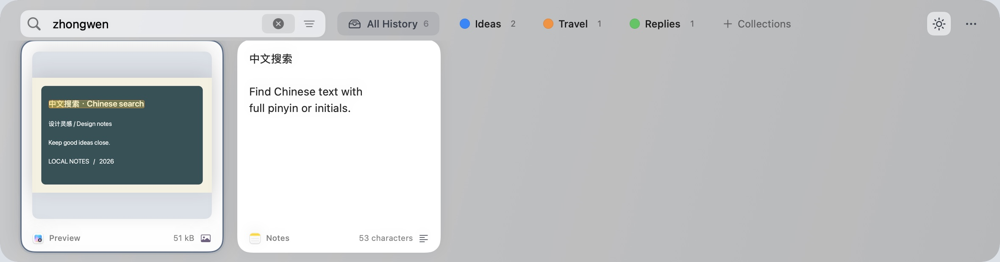

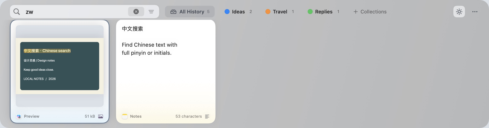

### Find words inside images

OCR runs locally in the background for new and existing images. Search results highlight the matching words directly on the image; press **Space** to inspect the same highlights in a larger preview.

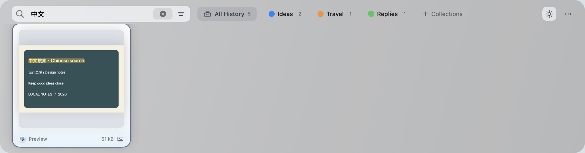

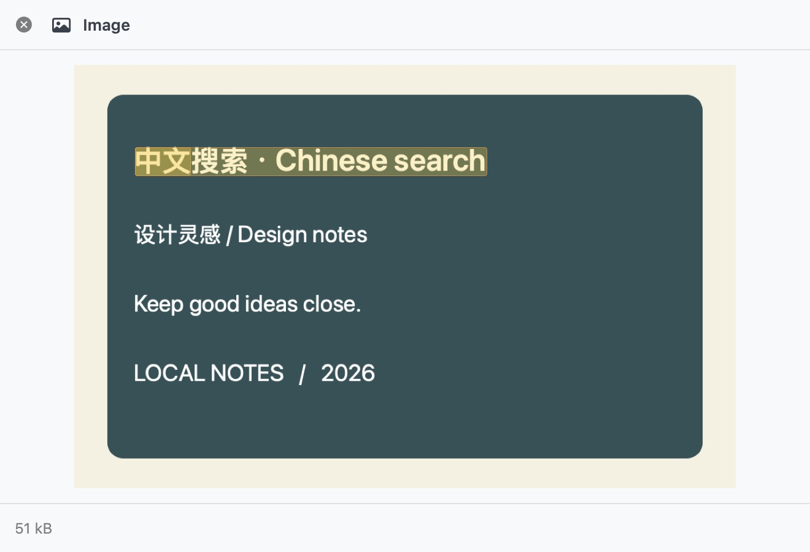

### Combine source apps and search

Select multiple source apps, then add keywords or a content-type filter. App tokens collapse into a compact count when they would take too much space; hover to see the full list, or click to remove sources individually.

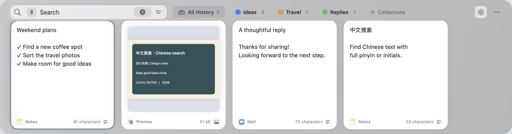

## Save your favorites in collections

Create collections for ideas, travel plans, reusable replies, or anything worth keeping. Give each collection a name and color, then drag cards into it.

Select several cards to organize them together. Drop cards onto **+ Collections** to create a collection as you go. Delete an unwanted card directly, and undo an accidental deletion with **⌘Z**.

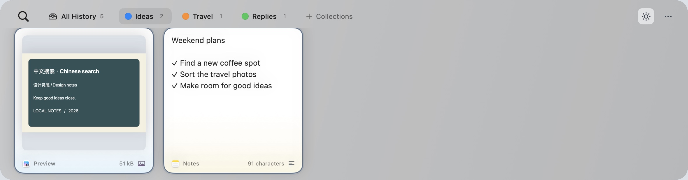

## Paste with fewer steps

- **Quick Paste:** with the shelf open, press **⌘1–9** to paste a numbered card. Hold **⌘** alone to reveal the numbers; modifier combinations keep hints hidden, including while releasing the keys. The same rule applies if you choose another modifier. By default, numbering starts at the leftmost card that is more than half visible. Turn off **Number from Visible Cards** in Keyboard Shortcuts to number from the start of the list.
- **Sequential Paste:** press **⇧⌘C** to start, then press it again to finish. Collect several items, then press **⌘V** in your destination app to paste them one at a time. Reverse the order or remove an item from the queue whenever needed.
- **Collection removal:** Delete inside a collection only removes its membership there; history and other collections keep the card. Undo restores the membership. Delete from clipboard history still removes the card everywhere.
- **Plain text:** paste without formatting when that is what you need.
- **Multiple selections:** copy, paste, organize, or delete several cards together.

Hold the configured modifier alone to reveal numbers and card times. Numbering can follow the visible cards instead of the start of the history.


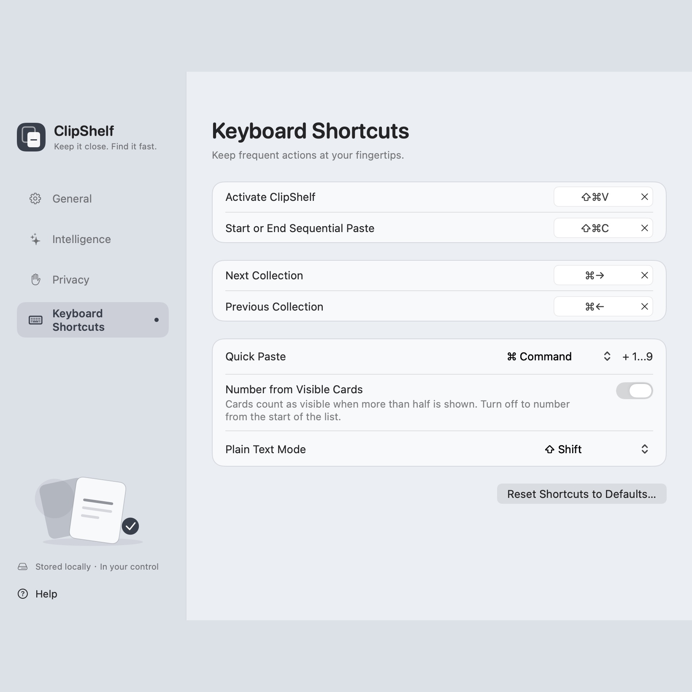

Build a queue, change its order, and paste each item into your destination app. Press the sequential shortcut again to finish.

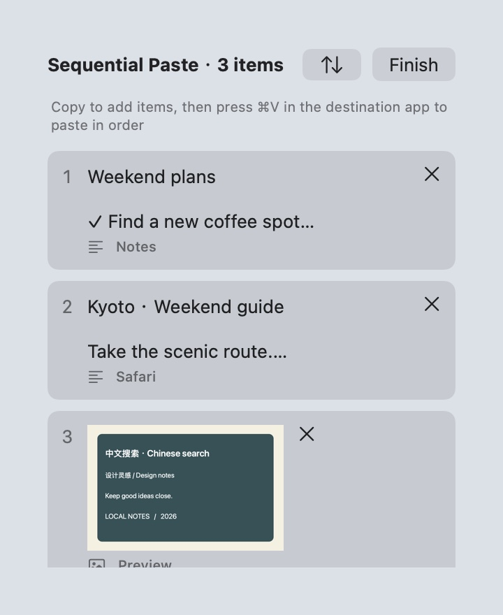

## Make it yours

Choose **English** or **中文**, set your own shortcuts, and decide how long to keep your history. Pick whether a card pastes into your current app or simply returns to the clipboard.

The interface combines a frosted-glass shelf, readable cards, and source-app colors. Open and dismiss it with a shortcut whenever you need it.

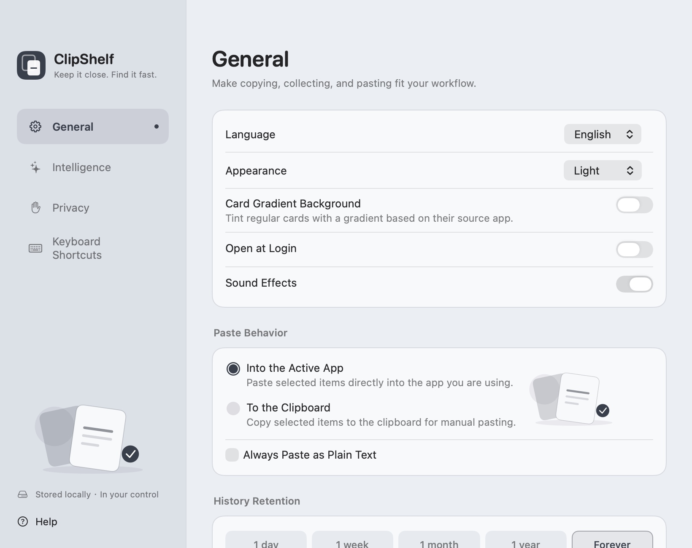

## Dark mode

Open **Settings → General → Appearance** and choose **Light**, **Dark**, or **System**.
You can also click the appearance icon to the left of **…** on the shelf to cycle through **System → Light → Dark**.

- **Light:** bright panels and white cards.
- **Dark:** dark cards, panels, and settings for a dimmer workspace, with source-app colors still visible.
- **System:** follow your Mac’s current appearance, including automatic changes.

Changes take effect immediately and your choice is remembered after restarting. Formatted text stays readable in dark mode while keeping its fonts and styling.

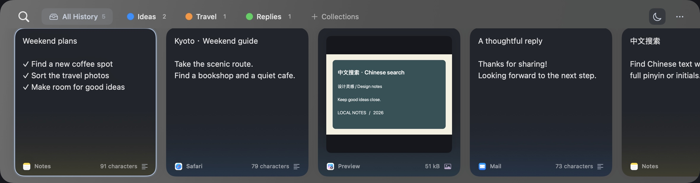

## Keyboard shortcuts

| Action | Shortcut |
| --- | --- |
| Show or hide ClipShelf | **⇧⌘V** |
| Start / End Sequential Paste | **⇧⌘C** |
| Search | **⌘F**, or start typing |
| Select the next / previous card | **Tab / ⇧Tab**, or **→ / ←** |
| Toggle a card in your selection | **⌘-click** |
| Select a range | **⇧-click** |
| Select all cards in the current view | **⌘A** |
| Preview the selected card | **Space** |
| Paste the selected card | **Return** or double-click |
| Quick Paste | **⌘1–9** |
| Copy without pasting | **⌘C** |
| Undo a card deletion | **⌘Z** |
| Create a collection | **⇧⌘N** |
| Open settings | **⌘,** |
| Close search or hide the shelf | **Esc** |

Activation shortcuts and paste modifiers can be customized in Settings. Text fields keep their usual editing shortcuts.

## You choose what to keep

- Keep your clipboard history on your Mac, without cloud sync.
- History expires only by your chosen retention period, with no item count, individual size, or total size limit; cards in collections do not expire. Changes are saved incrementally in background SQLite transactions, and the original archive is backed up during migration.
- Pause collection whenever you want.
- Exclude apps you do not want to save content from.
- Skip marked confidential or temporary content.
- Choose whether ClipShelf appears during screen sharing.
- Allow AI tools to use saved clips only after you approve access.

Direct pasting needs your permission in macOS settings. You can also copy a card and paste it yourself with **⌘V**.

---

*All screenshots show isolated sample content, never personal clipboard history.*

Screenshot generation is reproducible and runs offscreen without activating windows or reading the system clipboard. See [the screenshot renderer](docs/screenshots/README.md).
