<div align="center">

# ClipShelf

**留住刚刚复制的内容，需要时随手找回。**

[English](README.md) · [简体中文](README.zh-CN.md)

为 Mac 打造的剪贴板管理工具，支持历史搜索、收藏集与卡片式浏览。

**无需注册账号，无需订阅。**

</div>

## 下载

[**下载 ClipShelf 0.11.0 Mac 版**](https://github.com/zxdposter/ClipShelf/releases/download/v0.11.0/ClipShelf-0.11.0-macOS-arm64.dmg) · [ZIP 下载](https://github.com/zxdposter/ClipShelf/releases/download/v0.11.0/ClipShelf-0.11.0-macOS-arm64.zip) · [更新说明](https://github.com/zxdposter/ClipShelf/releases/tag/v0.11.0)

需要 **macOS 14 或更新版本**，以及搭载 **Apple 芯片（M1 或更新）** 的 Mac。打开 DMG，将 ClipShelf 拖入「应用程序」即可安装。

此版本尚未经过 Apple 公证。如果 macOS 阻止打开，请确认下载来源后，在 **系统设置 → 隐私与安全性 → 仍要打开** 中允许启动。

### 通过 Homebrew 安装

```sh
brew install --cask zxdposter/tap/clipshelf
```

如果 Homebrew 提示需要信任，请先运行 `brew trust --cask zxdposter/tap/clipshelf`，再重新执行安装命令。如果之前已手动安装，请退出 ClipShelf，并将原应用移出「应用程序」后再通过 Brew 安装，无需删除剪贴板历史和设置。

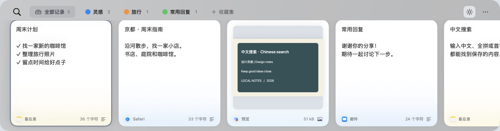

## 复制过的内容，随时找回

复制文字、链接、图片或文件后，打开 ClipShelf 就能再次找到。用清晰的卡片浏览历史，减少在不同应用之间来回切换。

- **剪贴板历史**：集中保存最近复制的内容，不再被下一次复制覆盖。
- **自动去重**：再次复制相同内容时，将原有卡片移到最前面。
- **搜索与筛选**：按内容、保存的标题或来源应用查找；中文支持全拼与首字母（如用 `zhongwen` 或 `zw` 搜索「中文」），也可按内容类型筛选。
- **图片文字搜索**：使用苹果本地 OCR，在后台识别新图片和已有历史图片中的中英文；支持中文、全拼和首字母搜索，在图片卡片和放大预览中高亮命中文字。单张图片文件会归为图片，已有误分类记录自动修正。识别结果持久缓存；输入、中文组字和连续切换卡片时，会中断识别并暂缓后续任务和结果更新。
- **按来源应用筛选**：从筛选菜单或输入时的应用建议中选择来源，可多选；已选应用显示为可移除标签，超宽后合并为数字标签，悬停查看完整列表、点击逐个移除。来源可与关键词、内容类型组合筛选。用 ↑↓ 选择建议、回车确认；搜索中按回车进入结果，再按回车粘贴，Tab / Shift-Tab 选择下一张 / 上一张卡片。
- **保留文字格式**：卡片直接展示格式文本、图片和文件缩略图。
- **空格预览**：粘贴前先查看完整文字、图片或文件。链接会在独立的临时 WebKit 会话中显示真实网页，可滚动、前进后退，也可手动在浏览器中打开。只有主动预览时才加载网页，不共享浏览器登录状态。
- **辨认来源**：通过 App 图标和卡片底部的颜色，快速识别内容来自哪里。

### 中文、全拼、首字母，都能找到

不用切换输入法，输入 `zhongwen` 或 `zw` 都能找到「中文」。图片识别出的文字同样支持这三种搜索方式。

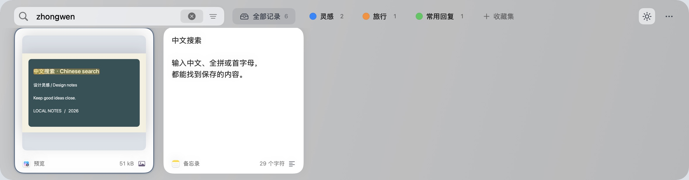

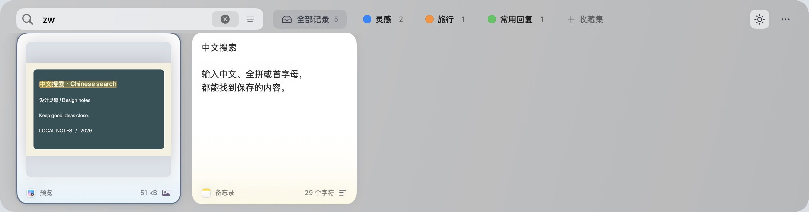

### 搜索图片里的文字

新图片和已有历史图片都在本机后台识别。搜索后，卡片中的命中文字会高亮；按 **空格** 放大预览，也能看到相同的高亮位置。

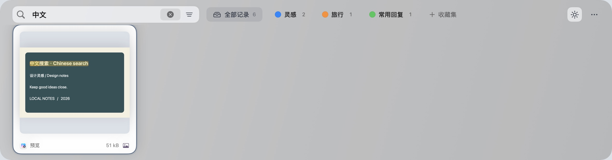

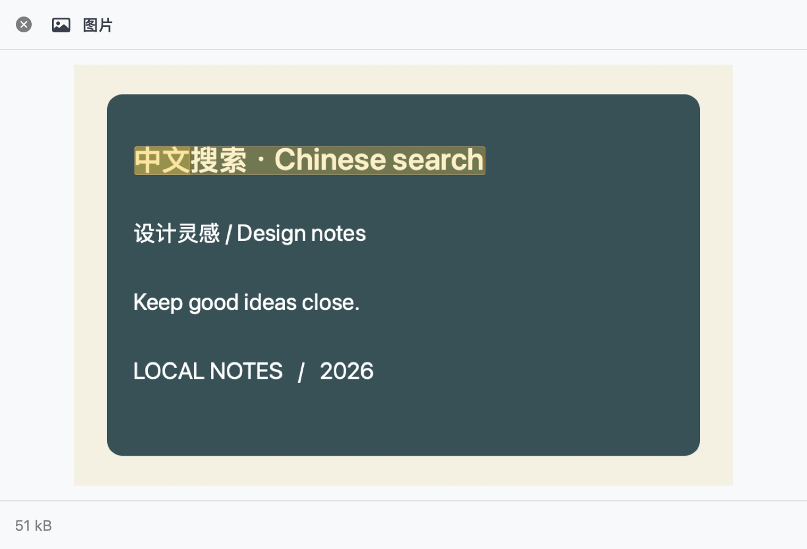

### 来源应用与关键词组合筛选

多选来源应用后，可以继续叠加关键词或内容类型。应用标签过宽时会合并为紧凑的数字标签，悬停查看完整列表，点击后逐个移除。

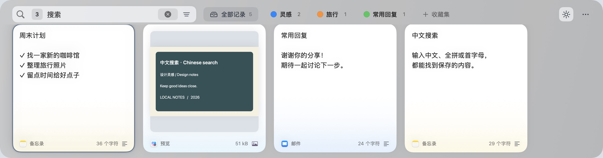

## 用收藏集留住常用内容

为灵感、旅行计划、常用回复或其他重要内容建立收藏集。设置名称和颜色，再把卡片拖进去即可。

支持多选卡片一起整理。将卡片拖到 **+ 收藏集** 上，即可在创建收藏集的同时加入卡片。不需要的卡片直接删除，误删时按 **⌘Z** 撤销。

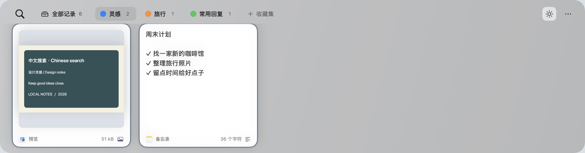

## 更少操作，完成粘贴

- **快速粘贴**：打开面板后，按 **⌘1–9** 粘贴对应卡片，单独按住 **⌘** 即可查看编号。与其他修饰键组合时不显示，松开过程中也不会闪回；改用其他修饰键时同理。默认从最左侧显示超过一半的可见卡片开始编号；可在「键盘快捷键」中关闭「从可见卡片开始编号」，恢复从列表第一张编号。
- **顺序粘贴**：按 **⇧⌘C** 启动，再次按下结束。先连续复制多个内容，再到目标应用按 **⌘V** 逐项粘贴。支持反转顺序或移除队列中的单项。
- **移出收藏集**：在收藏集内删除只解除当前收藏集的关联，历史记录和其他收藏集中的卡片均保留，也支持撤销。从全部历史记录中删除仍会移除所有位置的卡片。
- **纯文本粘贴**：需要时去掉文字格式，直接粘贴纯文本。
- **多选操作**：多张卡片一起复制、粘贴、整理或删除。

单独按住配置的修饰键时，显示编号和卡片时间；可以从当前可见卡片开始编号，无需从历史第一张算起。

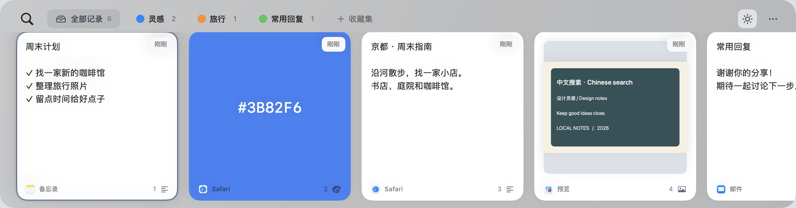

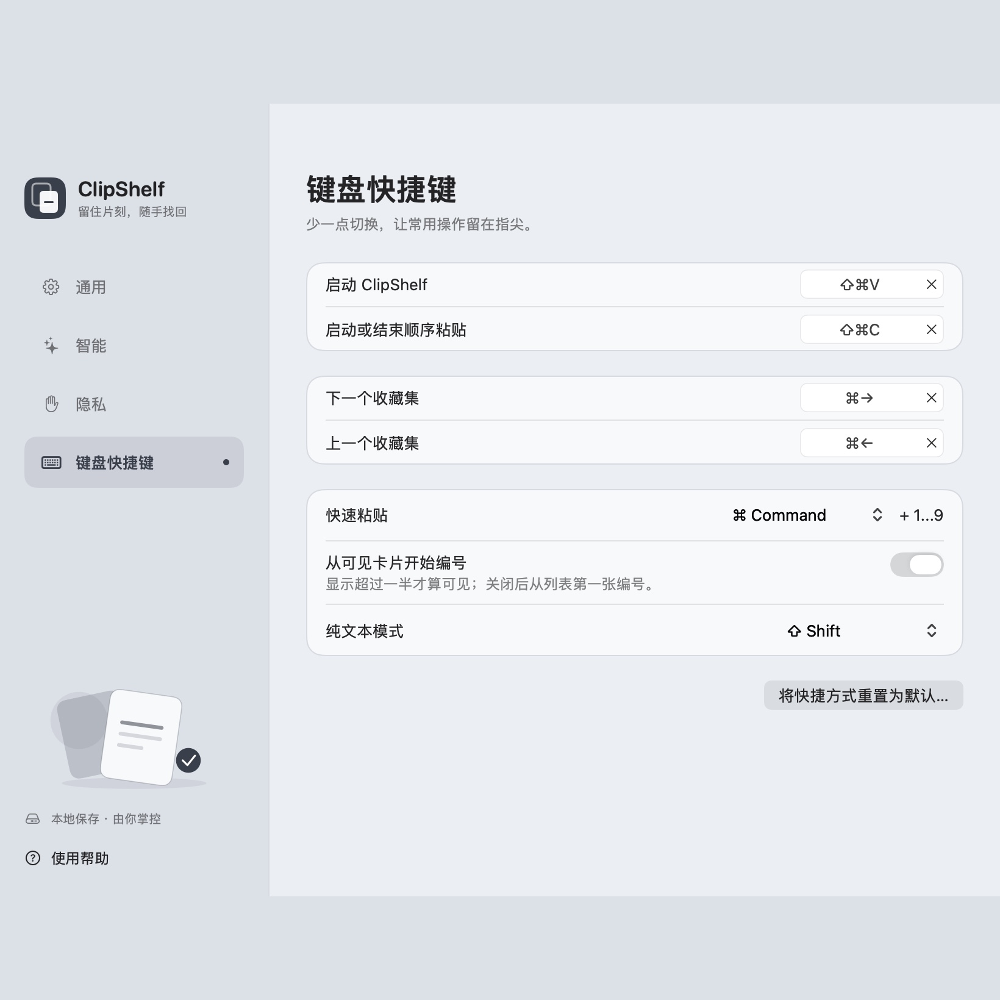

先收集队列、调整顺序，再到目标应用逐项粘贴；再次按下顺序粘贴快捷键即可结束。

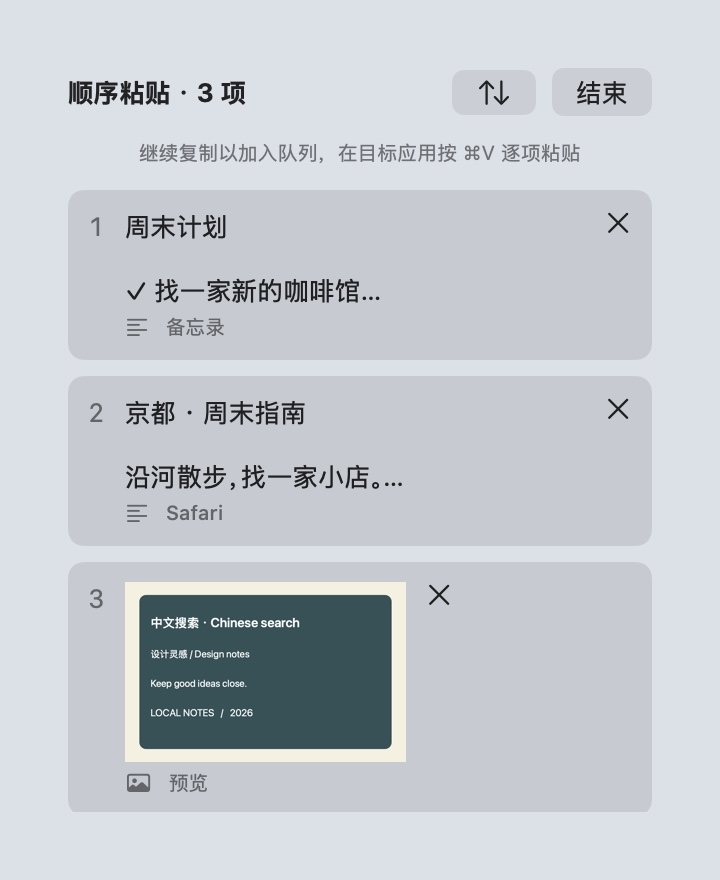

## 按你的习惯使用

支持 **中文** 和 **English**，可以自定义快捷键、历史保留时间，以及粘贴到当前应用还是仅复制到剪贴板。

毛玻璃面板搭配清晰的卡片和来源 App 色带，需要时按快捷键呼出，用完即可收起。

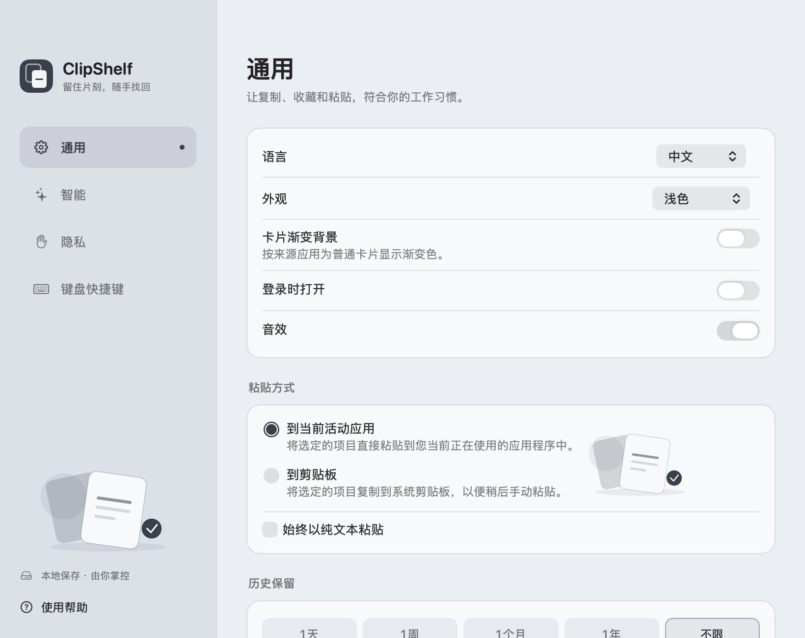

## 夜间模式

打开 **设置 → 通用 → 外观**，选择 **浅色、深色或跟随系统**。
也可以点击主界面 **…** 左侧的外观图标，依次切换 **跟随系统 → 浅色 → 深色**。

- **浅色**：明亮面板搭配纯白卡片。
- **深色**：卡片、面板和设置页使用深色外观，适合光线较暗的工作环境，同时保留来源 App 色带。
- **跟随系统**：跟随 Mac 当前的外观，包括系统的自动切换。

切换立即生效，重启后仍保留选择。格式文本在深色模式下保持可读，并保留字体与样式。

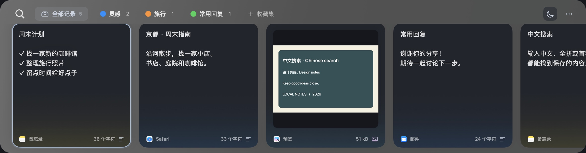

## 常用快捷键

| 操作 | 快捷键 |
| --- | --- |
| 呼出或收起 ClipShelf | **⇧⌘V** |
| 启动 / 结束顺序粘贴 | **⇧⌘C** |
| 搜索 | **⌘F**，或直接输入 |
| 选择下一张 / 上一张卡片 | **Tab / ⇧Tab**，或 **→ / ←** |
| 增加或取消单张选择 | **⌘ 点击** |
| 连续选择多张卡片 | **⇧ 点击** |
| 全选当前视图中的卡片 | **⌘A** |
| 预览选中卡片 | **空格** |
| 粘贴选中卡片 | **回车**或双击 |
| 快速粘贴 | **⌘1–9** |
| 仅复制，不直接粘贴 | **⌘C** |
| 撤销删除卡片 | **⌘Z** |
| 新建收藏集 | **⇧⌘N** |
| 打开设置 | **⌘,** |
| 关闭搜索或收起面板 | **Esc** |

可在设置中修改呼出、顺序粘贴、收藏集切换快捷键及粘贴修饰键。输入框内仍保留常用的文字编辑快捷键。

## 自己决定保存什么

- 历史保存在本机，无需云同步。
- 历史仅按设置的保留时间清理，不限制记录条数、单条大小和总容量；收藏集中的卡片不按时间清理。改动通过后台 SQLite 事务增量保存，迁移时保留原始存档备份。
- 随时暂停采集。
- 忽略不希望保存内容的应用。
- 跳过带有机密或临时标记的内容。
- 选择屏幕共享时是否显示 ClipShelf。
- 只有经过你的批准，AI 工具才能访问保存的内容。

直接粘贴需要你在 macOS 设置中授权。也可以只复制卡片，再自行按 **⌘V** 粘贴。

---

*所有截图均使用独立示例内容，不包含个人剪贴板历史。*

截图可通过[离屏渲染脚本](docs/screenshots/README.md)重新生成：不激活窗口、不读取系统剪贴板，也不打断前台操作。
